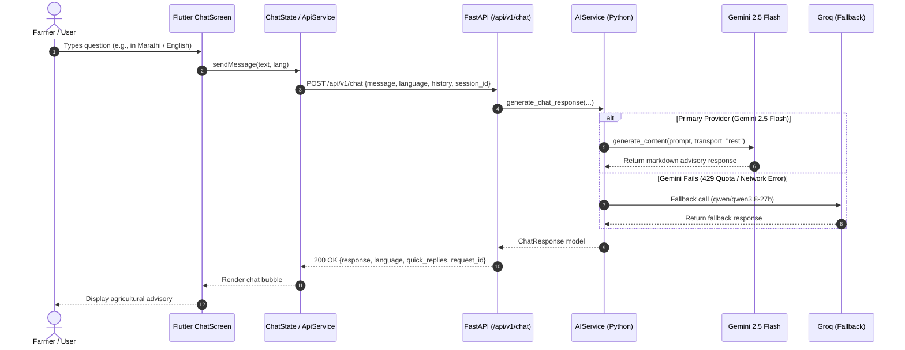
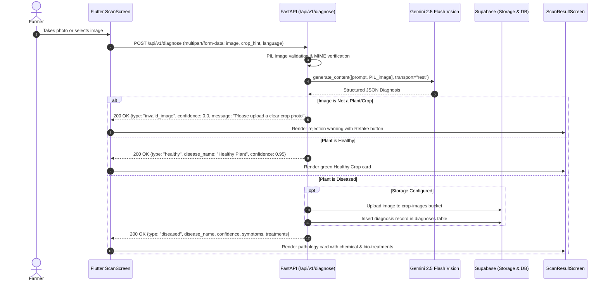
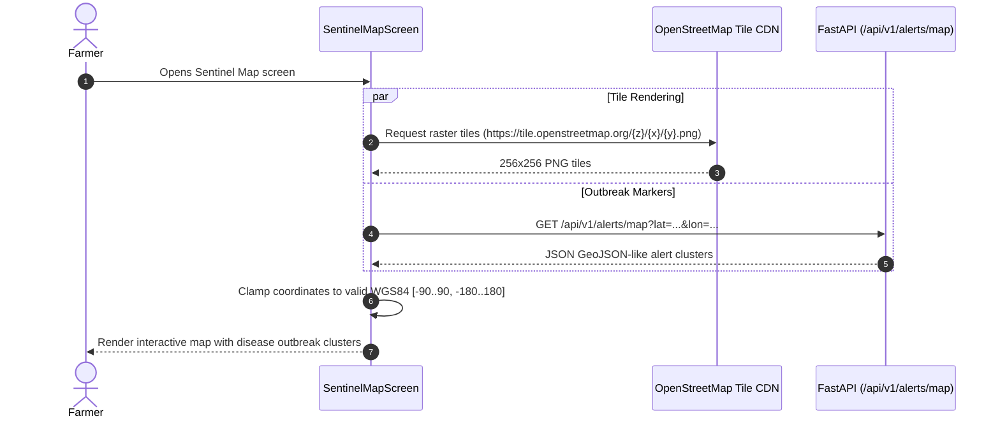

# Krishi Vikas AI — Phase 0 Request Flows & Lifecycles

**Document:** `docs/architecture/PHASE_0_REQUEST_FLOWS.md`  
**Date:** October 21, 2026  
**Auditor:** Senior Architect & Release Engineer  

---

## 1. AI Chat Request Lifecycle

### Key Chat Implementation Details
- **Endpoint:** `POST /api/v1/chat` and `/chat` (aliased).
- **Request Model:** `ChatRequest` (`message: str`, `language: str = "en"`, `history: List[ChatMessage] = []`, `context: Optional[dict] = None`, `session_id: Optional[str] = None`).
- **Response Model:** `ChatResponse` (`response: str`, `detected_language: str`, `intent: str`, `quick_replies: List[str]`, `references: List[str]`, `request_id: str`).
- **Resilience Fix:** If both Gemini and Groq fail (e.g. Gemini quota exhausted and Groq unconfigured), backend returns `502 Bad Gateway` with structured error details instead of a fake static advisory. Flutter displays a red retry bubble allowing the farmer to re-send.

---

## 2. Crop Scan Request Lifecycle

### Critical Findings & Verified Bug Fixes
- **Elimination of Fake Fallbacks:** The previous codebase contained a mock fallback (`"Leaf Disease Detected"`, `confidence: 0.85`) that triggered whenever Gemini Vision failed, giving farmers false diagnostic data. This was eliminated:
  - If the AI fails, an explicit `502 Bad Gateway` error is returned.
  - If a non-crop image (e.g. a shoe, chair, or random photo) is submitted, the vision prompt classifies it as `type: "invalid_image"` with `confidence: 0.0`.
  - Non-crop images are **not** written to Supabase `diagnoses`, preserving history integrity.

---

## 3. Sentinel Map Request Lifecycle

### Verified Map Fixes
- **Root Cause of Blank Map:** The previous code queried `basemaps.cartocdn.com` which blocked anonymous requests or timed out.
- **Fix:** Switched to standard OpenStreetMap raster tiles with `NetworkTileProvider()`, proper HTTP User-Agent (`com.krishivikas.ai`), legal attribution widget, and `errorTileCallback` which displays an in-app error banner if offline.

---

## 4. My Farm Request Lifecycle

- **Entry Point:** `flutter_app/lib/screens/farm/my_farm_screen.dart`
- **Data Flow:**
  - Queries `/api/v1/farm/summary?user_id=...`
  - Fetches farm profile from Supabase `farms` table and recent soil logs from `soil_logs`.
  - **Telemetry Status:** Soil moisture, NPK ratios, and temperature telemetry curves currently use deterministic algorithmic demo values rendered via `fl_chart`. Physical ESP32 sensor hardware is not yet integrated.

---

## 5. Auxiliary Modules Request Flows

| Module | Route / Endpoint | Data Source / Backing Mechanism |
| :--- | :--- | :--- |
| **Mandi Prices** | `GET /api/v1/market/prices` | Local structured dataset `backend/data/mandi_prices.json` |
| **Government Schemes** | `GET /api/v1/schemes` | Local structured dataset `backend/data/schemes.json` |
| **Weather Information** | `GET /api/v1/weather/current` | Open-Meteo REST API with local IMD weather cache fallback |
| **Disease Outbreak Alerts**| `GET /api/v1/alerts` | Algorithmic cluster aggregation based on recent crop scan locations |
| **Voice Assistance (STT/TTS)**| `POST /api/v1/voice/stt` / `/tts` | Device OS speech recognition + backend TTS synthesis endpoint |
