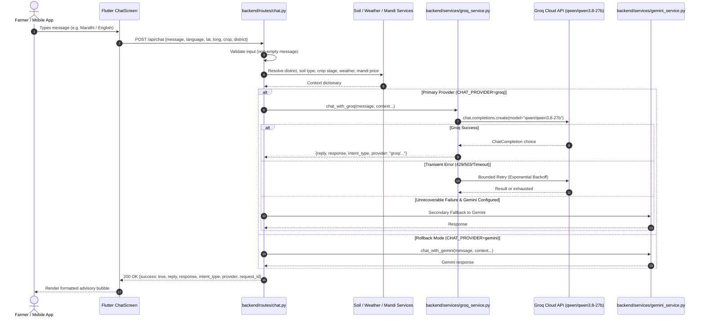

# Krishi Vikas AI — Phase 1 Chat Integration Specification

**Document:** `docs/architecture/PHASE_1_CHAT_INTEGRATION.md`  
**Date:** October 21, 2026  
**Auditor:** Senior Architect & AI Systems Engineer  
**Status:** IMPLEMENTED & VERIFIED  

---

## 1. Architectural Scope & Objectives

The primary objective of Phase 1 was to migrate the conversational agricultural chatbot to Groq Cloud while maintaining 100% backward compatibility with:
1. Flutter client application contract (`/api/chat`).
2. Legacy and REST endpoint aliases (`/api/v1/chat`, `/chat`, `/farms/{id}/chat`).
3. Multilingual capabilities (Hindi, Marathi, Tamil, English).
4. Agricultural context enrichment (soil mapping, crop calendar, weather, mandi prices).
5. Complete decoupling and zero disturbance to Crop Scan (`routes/diagnose.py`).

---

## 2. Request & Response Lifecycle (Post-Migration)



---

## 3. API Contract Preservation

### 3.1 Request Contract (`ChatRequest`)
```json
{
  "message": "सोयाबीनची लागवड कशी करावी?",
  "language": "mr",
  "lat": 19.997,
  "long": 73.789,
  "crop": "Soybean",
  "district": "Nashik",
  "last_diagnosis": "None"
}
```

### 3.2 Normalized Response Contract
```json
{
  "success": true,
  "reply": "सोयाबीन लागवडीसाठी जमीन चांगली भुसभुशीत करा...",
  "response": "सोयाबीन लागवडीसाठी जमीन चांगली भुसभुशीत करा...",
  "intent_type": "general",
  "provider": "groq/qwen/qwen3.8-27b",
  "request_id": "8489cf39-25f0-4fa4-a14a-58b291d03ce7"
}
```

### 3.3 Structured Error Contract (HTTP 503 / 500)
```json
{
  "success": false,
  "reply": "The AI assistant is temporarily unavailable. Please try again shortly.",
  "response": "The AI assistant is temporarily unavailable. Please try again shortly.",
  "error": {
    "code": "UPSTREAM_UNAVAILABLE",
    "message": "The AI assistant is temporarily unavailable. Please try again shortly.",
    "request_id": "8489cf39-25f0-4fa4-a14a-58b291d03ce7",
    "retryable": true
  }
}
```

---

## 4. Agricultural Safety Guardrails Implemented

The Groq prompt incorporates 10 explicit safety directives:
1. **Direct Answer Focus:** Always answer the farmer's specific query directly; context enriches rather than displaces the user's focus.
2. **Missing Information Inquiry:** Promptly ask 1-2 focused questions when vital information (crop stage, symptom color/distribution) is absent.
3. **Calibrated Uncertainty:** Avoid claiming certainty when ambiguous symptoms could stem from fungal, bacterial, or abiotic stressors.
4. **Visual Grounding Truthfulness:** Explicitly prohibits claiming to have inspected images or visual symptoms when text-only mode is active.
5. **No Telemetry/Hardware Fabrication:** Never claim live sensor or pump control capabilities.
6. **No Subsidy/Scheme Fabrication:** Do not hallucinate government subsidies, loan waivers, or fictitious telephone helplines.
7. **Pesticide Product Label Primacy:** Instruct farmers that manufacturer product labels override conversational advice regarding exact dilutions, PPE, and pre-harvest intervals.
8. **KVK Escalation:** Advise farmers to consult their local Krishi Vigyan Kendra (KVK) or extension officer for severe or ambiguous infestations.
9. **No Hardware Actuation:** Prevent claims of remote device automation.
10. **Multilingual Consistency:** Retain Class 6 level clarity across Marathi, Hindi, Tamil, and English.
